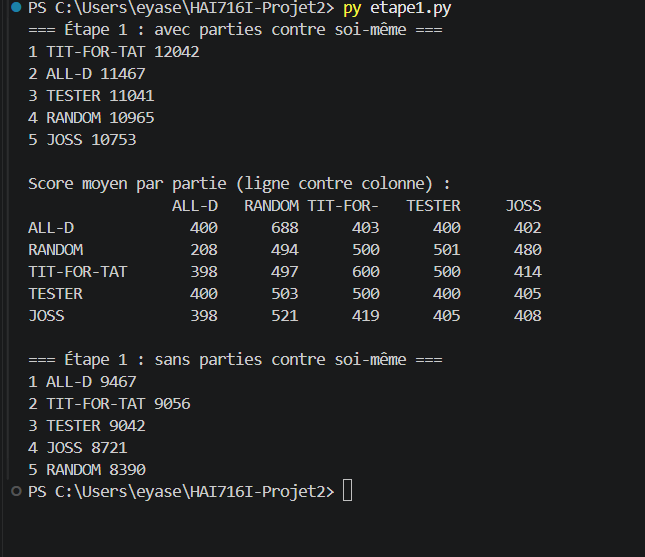

# Journal de bord – HAI716I Projet 2, partie 1

Projet réalisé seule. Langage : Python.

## 1. Protocole

- **Matrice de gains** (celle du cours) :

  |             | adversaire C | adversaire D |
  |-------------|--------------|--------------|
  | **moi C**   | 3, 3         | 0, 5         |
  | **moi D**   | 5, 0         | 2, 2         |

- **Format du tournoi** : chaque paire de stratégies joue 5 parties de 200 tours (format d'Axelrod, imposé par l'énoncé). Le score d'une stratégie est la somme de tous ses points sur le tournoi.
- **Parties contre soi-même** : oui, chaque stratégie joue aussi contre une copie d'elle-même (on ne compte qu'un des deux scores). Axelrod le faisait dans son tournoi. Je relance aussi le tournoi sans ces parties pour voir si ce choix change le classement.
- **Graine aléatoire** : `random.seed(42)` au début de chaque tournoi, pour que RANDOM et JOSS fassent toujours les mêmes tirages et que les résultats soient reproductibles. 42 est un choix arbitraire, n'importe quel nombre fixe marche.
- **Représentation d'une stratégie** : une fonction `strategie(mes_coups, coups_adv)` qui reçoit les deux historiques et renvoie `'C'` ou `'D'`. Dans le moteur, les deux coups sont demandés avant d'être ajoutés aux historiques : aucune stratégie ne voit le coup de l'autre au même tour (coups simultanés).

### Vérification du moteur

Avant de lancer le tournoi, j'ai vérifié le moteur avec l'exemple du cours (diapositive 67) : sur 10 tours, TIT-FOR-TAT contre ALL-D doit donner 18 contre 23.
Commande : `py test.py`, résultat obtenu : `(18, 23)`. Le moteur calcule bien les points.

## 2. Les stratégies du cours

**ALL-D**
- *Règle* : trahit à chaque tour.
- *Origine* : c'est la stratégie « rationnelle » quand le nombre de tours est connu (raisonnement par récurrence à rebours, vu en cours).
- *Devrait bien jouer contre* : les stratégies qui ne ripostent pas, comme RANDOM, qui coopère une fois sur deux.
- *Devrait mal jouer contre* : les stratégies qui ripostent (TIT-FOR-TAT, JOSS), car après le 1er tour elles trahissent aussi et ALL-D ne gagne plus que 2 par tour.

**RANDOM**
- *Règle* : joue C ou D au hasard, avec une chance sur deux.
- *Origine* : stratégie témoin du tournoi d'Axelrod.
- *Devrait bien jouer contre* : personne en particulier.
- *Devrait mal jouer contre* : ALL-D, qui l'exploite chaque fois qu'elle coopère. Elle sert de référence : une bonne stratégie doit faire mieux qu'elle.

**TIT-FOR-TAT**
- *Règle* : coopère au 1er tour, puis copie le dernier coup de l'adversaire.
- *Origine* : Anatol Rapoport, gagnante du tournoi d'Axelrod en 1980.
- *Devrait bien jouer contre* : les stratégies qui coopèrent (coopération totale, 600 points par partie).
- *Devrait mal jouer contre* : JOSS, dont les trahisons surprises déclenchent des représailles en écho. D'après le cours, elle ne gagne jamais un duel : elle ne peut gagner qu'en accumulant des points sur tout le tournoi.

**TESTER**
- *Règle* : trahit au 1er tour. Si l'adversaire riposte, elle joue TIT-FOR-TAT ; sinon elle répète le motif C, C, D.
- *Origine* : stratégie soumise au tournoi d'Axelrod.
- *Mon interprétation* : « riposter » veut dire que l'adversaire a joué D au moins une fois. Dès que c'est le cas, TESTER joue TIT-FOR-TAT jusqu'à la fin.
- *Devrait bien jouer contre* : les stratégies qui ne ripostent jamais, qu'elle exploite avec son motif.
- *Devrait mal jouer contre* : les stratégies qui ripostent, car sa trahison du 1er tour lance des représailles.

**JOSS**
- *Règle* : comme TIT-FOR-TAT, mais remplace un C par un D une fois sur dix.
- *Origine* : stratégie soumise au tournoi d'Axelrod.
- *Devrait bien jouer contre* : les stratégies qui coopèrent sans riposter.
- *Devrait mal jouer contre* : TIT-FOR-TAT et elle-même, car chaque trahison surprise déclenche des représailles.

## 3. Étape 1 : le tournoi de base

### Prédiction (écrite avant le lancement)

Je pense que TIT-FOR-TAT va gagner, comme dans le tournoi d'Axelrod : elle coopère avec ceux qui coopèrent et punit ceux qui trahissent, donc elle ne se fait jamais exploiter longtemps. TESTER pourrait être juste derrière, car elle exploite les stratégies qui ne ripostent pas, mais contre TIT-FOR-TAT et JOSS sa trahison du premier tour déclenche des représailles. Je pense que RANDOM sera dernière : elle joue au hasard, donc ALL-D l'exploite quand elle coopère et les stratégies qui ripostent la punissent quand elle trahit.

### Résultats

Commande : `py etape1.py`

    === Avec parties contre soi-même ===
    1 TIT-FOR-TAT 12042
    2 ALL-D 11467
    3 TESTER 11041
    4 RANDOM 10965
    5 JOSS 10753

    Score moyen par partie (ligne contre colonne) :
                    ALL-D   RANDOM TIT-FOR-   TESTER     JOSS
    ALL-D             400      688      403      400      402
    RANDOM            208      494      500      501      480
    TIT-FOR-TAT       398      497      600      500      414
    TESTER            400      503      500      400      405
    JOSS              398      521      419      405      408

    === Sans parties contre soi-même ===
    1 ALL-D 9467
    2 TIT-FOR-TAT 9056
    3 TESTER 9042
    4 JOSS 8721
    5 RANDOM 8390

### TIT-FOR-TAT gagne-t-elle ?

Oui, mais de justesse, et seulement avec les parties contre soi-même. Sans elles, c'est ALL-D qui gagne. Le tableau des duels explique pourquoi :
- **TIT-FOR-TAT ne gagne aucun duel**, comme dans le cours : 398 contre 403 face à ALL-D, 500 contre 500 face à TESTER, 414 contre 419 face à JOSS. Elle gagne uniquement grâce à son match contre elle-même (600, le maximum possible). C'est le seul match du tournoi où il y a une coopération totale. Sans ce match, elle repasse derrière ALL-D.
- **Il n'y a presque pas de stratégies « gentilles » dans la population.** TIT-FOR-TAT est la seule qui ne trahit jamais en premier. Les autres trahissent tout le temps (ALL-D), d'entrée (TESTER), au hasard (RANDOM) ou de temps en temps (JOSS). Le cours dit que TIT-FOR-TAT ne réussit que si elle rencontre assez de stratégies coopératives. En 1980, il y en avait beaucoup ; ici, il n'y en a pas.
- **ALL-D exploite RANDOM** (688, le plus gros score du tableau) et perd peu contre les autres (environ 400, soit 2 points par tour). Dans une population aussi méfiante, ne jamais coopérer coûte peu.
- **Les représailles coûtent cher.** Contre TESTER, TIT-FOR-TAT tombe dans une alternance (l'une trahit pendant que l'autre coopère, à tour de rôle) : 500 chacune au lieu de 600. Contre JOSS, les trahisons surprises déclenchent des représailles et les deux finissent autour de 415.

### Comparaison avec ma prédiction

- TIT-FOR-TAT première : **juste**, mais seulement avec les parties contre soi-même, ce que je n'avais pas prévu.
- TESTER deuxième : **faux**, c'est ALL-D. J'avais sous-estimé ce qu'ALL-D gagne contre RANDOM (688), et le fait que les stratégies qui ripostent ne la punissent pas vraiment : elles la ramènent seulement à 2 points par tour.
- RANDOM dernière : **faux** avec les parties contre soi-même (c'est JOSS, dont les trahisons surprises font tomber tous ses matchs en représailles), mais **juste** sans elles.

## Impasses
**Impasse 1 : erreur de syntaxe dans la matrice.** Au premier lancement, Python affichait `SyntaxError: invalid syntax` à la ligne 8 de `moteur.py`. J'avais séparé les éléments du dictionnaire `GAINS` par des `;` au lieu de `,`. Corrigé en mettant des virgules.

**Impasse 2 : la partie s'arrêtait après un tour.** Le test donnait `(0, 5)` au lieu de `(18, 23)` : c'est le score d'un seul tour (TFT coopère, ALL-D trahit). Le `return score1, score2` était indenté *dans* la boucle `for`, donc la fonction s'arrêtait dès la fin du 1er tour. Corrigé en mettant le `return` au même niveau que le `for`. Sans le test avec l'exemple du cours, je ne l'aurais pas vu tout de suite.

## 4. Étape 2 : nouvelles stratégies

J'ajoute deux stratégies absentes du cours, choisies parce qu'elles sont opposées sur la question du pardon.

**GRIM (Grim Trigger)**
- *Règle* : coopère tant que l'adversaire n'a jamais trahi. Dès sa première trahison, trahit jusqu'à la fin de la partie.
- *Origine* : stratégie classique de la théorie des jeux répétés (Friedman, 1971).
- *Idée testée* : que se passe-t-il si on ne pardonne jamais ?
- *Devrait bien jouer contre* : TIT-FOR-TAT et elle-même (coopération totale, 600 points), car aucune des deux ne trahit en premier.
- *Devrait mal jouer contre* : JOSS : une seule trahison surprise de JOSS et GRIM trahit pour toujours, alors que la coopération aurait pu reprendre.

**TFT-GÉNÉREUX (Generous Tit-for-Tat)**
- *Règle* : comme TIT-FOR-TAT, mais quand l'adversaire a trahi, elle pardonne une fois sur dix (elle rejoue C au lieu de riposter).
- *Origine* : Nowak et Sigmund (1992), présentée dans le cours (diapositive 72) comme une solution aux représailles en écho.
- *Idée testée* : le pardon permet-il de sortir des représailles ?
- *Devrait bien jouer contre* : JOSS et TESTER : le pardon peut casser l'alternance de représailles vue à l'étape 1 (500 points contre TESTER).
- *Devrait mal jouer contre* : ALL-D, qui profite de chaque pardon (elle prend 0 point au lieu de 2 à chaque fois).

### Prédiction (écrite avant le lancement)

À l'étape 1, TIT-FOR-TAT était la seule stratégie gentille, et elle ne gagnait que grâce à son match contre elle-même. Avec GRIM et TFT-GÉNÉREUX, il y a maintenant trois stratégies qui ne trahissent jamais en premier : elles devraient coopérer entre elles et marquer 600 points par partie, donc je pense que les trois vont prendre les premières places. Je pense que TFT-GÉNÉREUX sera devant TIT-FOR-TAT, parce que son pardon peut casser l'alternance contre TESTER et les représailles contre JOSS. GRIM devrait être juste derrière, car elle ne pardonne jamais à JOSS. ALL-D devrait descendre au classement : elle marque toujours environ 400 contre ceux qui ripostent, mais les stratégies gentilles marquent maintenant 600 entre elles. RANDOM et JOSS devraient rester en bas.